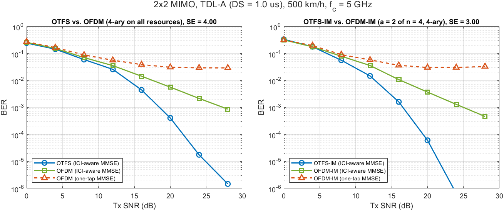
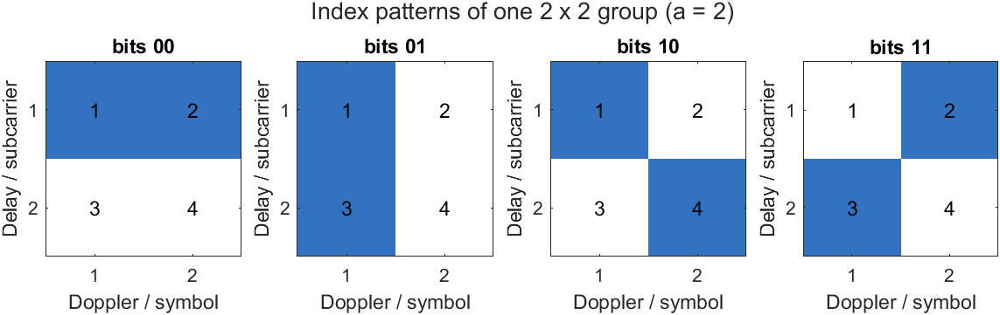
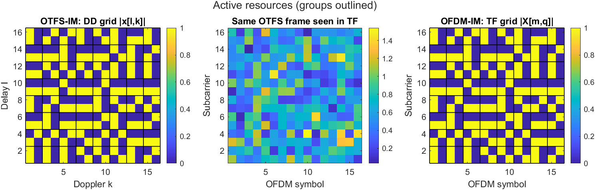
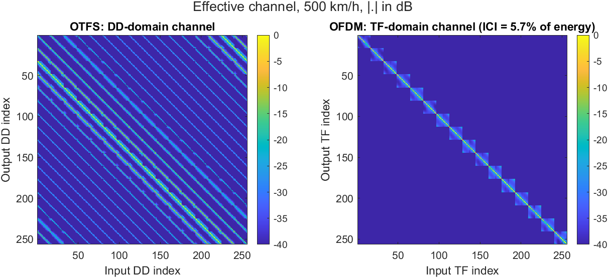

# OTFS vs. OFDM and OTFS-IM vs. OFDM-IM at High Mobility

MATLAB Live Script that compares **OTFS** and **OFDM**, with and without **index modulation (IM)**, at **500 km/h** over a 3GPP TDL-A channel with 2×2 MIMO. It shows the mapping, the channel each waveform sees, the detection equations, and the BER.

## What question does it answer?

At high speed, Doppler destroys the orthogonality of OFDM subcarriers and causes inter-carrier interference (ICI). OTFS places the symbols in the delay-Doppler domain instead.

Many comparisons give OTFS a strong equalizer and OFDM a simple one-tap equalizer, so part of the gap comes from the receiver. This script separates the two effects by testing OFDM with both receivers:

| Receiver | Equalizer | What it knows about the channel |
|---|---|---|
| OTFS | Full-frame MMSE | Everything (delay and Doppler) |
| OFDM, ICI-aware | Full-frame MMSE | Everything, including ICI |
| OFDM, one-tap | One small MMSE per subcarrier | Only the main diagonal (ICI ignored) |

## Main results

BER at 20 dB (2×2 MIMO, 500 km/h, 5 GHz, up to 2000 frames per point):

| Receiver | Plain QPSK (4 bits/resource) | IM, 2 of 4 active, QPSK (3 bits/resource) |
|---|:-:|:-:|
| OTFS | 4.1e-4 | 6.1e-5 |
| OFDM, ICI-aware | 5.6e-3 | 3.7e-3 |
| OFDM, one-tap | 3.1e-2 (error floor) | 3.0e-2 (error floor) |

- **One-tap OFDM** has an error floor, because the ignored ICI grows with the signal power.
- **ICI-aware OFDM** removes the floor, but its BER falls slowly.
- **OTFS** falls faster, because each symbol is spread over the whole time-frequency frame and sees more of the channel paths.

Plain and IM run at different spectral efficiency, so compare OTFS with OFDM inside a panel, not plain with IM.

## How it works

### 1. Index modulation mapping

Each group of `n = 4` resources has `a = 2` active resources. The choice of active positions carries extra bits:

$$b = \left\lfloor \log_2 \binom{n}{a} \right\rfloor + a \log_2 \mathcal{M} = 2 + 4 = 6 \text{ bits per group}$$

### 2. Where the symbols are placed

OTFS fills the delay-Doppler grid, OFDM fills the time-frequency grid. The middle panel shows the same OTFS frame in the time-frequency plane: its energy is spread everywhere.

### 3. The channel each waveform sees

### 4. Detection

**Step 1: equalize.** With $\lambda = N_0 N_t$:

OTFS, with $\mathbf{A}=\mathbf{F}_N^H\otimes\mathbf{I}_M$:

$$\hat{\mathbf{x}} = (\mathbf{I}_{N_t}\otimes\mathbf{A}^H)\left(\mathbf{G}^H\mathbf{G}+\lambda\mathbf{I}\right)^{-1}\mathbf{G}^H\mathbf{r}$$

OFDM, ICI-aware, where $\mathbf{H}_o$ is the full effective channel after CP removal:

$$\hat{\mathbf{x}} = \left(\mathbf{H}_o^H\mathbf{H}_o+\lambda\mathbf{I}\right)^{-1}\mathbf{H}_o^H\mathbf{r}_o$$

OFDM, one-tap, for each resource $k$:

$$\hat{\mathbf{x}}_k = \left(\mathbf{H}_{k,k}^H\mathbf{H}_{k,k}+\lambda\mathbf{I}\right)^{-1}\mathbf{H}_{k,k}^H\mathbf{y}_k$$

**Step 2: look-up-table (LUT) detection.** Every group is matched to the nearest valid codeword, which gives the index bits and symbol bits together:

$$\hat{c} = \arg\min_{c} \left\| \mathbf{z}_{g,t} - \mathbf{u}_c \right\|^2$$

The full derivation and notation are in Section 6 of the Live Script.

## Files

| File | Purpose |
|---|---|
| `OFDM_vs_OTFS_IM_Diversity.mlx` | Live Script with formatted equations and saved outputs. Open this in MATLAB. |
| `OFDM_vs_OTFS_IM_Diversity.m` | The same script as plain text, readable on GitHub. |
| `figures/` | Figures used on this page. |

## How to run

1. Open `OFDM_vs_OTFS_IM_Diversity.mlx` in MATLAB. It was developed in R2024a and needs only base MATLAB (no toolboxes; R2022a or newer because of `clim`).
2. For a check that takes a few seconds, set `quickTest = true` in Section 1.
3. Run all sections. The full run takes about 10 minutes.

All settings are in Section 1. The main ones:

| Parameter | Default | Meaning |
|---|---|---|
| `M`, `N` | 16, 16 | Delay bins / subcarriers, Doppler bins / symbols |
| `Nt`, `Nr` | 2, 2 | Transmit and receive antennas |
| `MG`, `NG`, `a` | 2, 2, 2 | Group size and active resources |
| `Mmod`, `MmodPlain` | 4, 4 | QPSK for IM and for plain transmission |
| `v_kmh`, `fc`, `df` | 500, 5 GHz, 15 kHz | Speed, carrier, subcarrier spacing |
| `DS` | 1 µs | TDL-A delay spread |
| `cpLen` | automatic | OFDM cyclic prefix length |

## Built-in checks

The script stops with an error if any of these fail:

1. The OTFS and OFDM transforms are unitary.
2. Time-domain MMSE gives the same result as delay-Doppler MMSE for OTFS.
3. All schemes transmit the same power per resource.
4. A clean channel gives zero bit errors for every receiver.
5. The CP makes OFDM exactly interference-free at 0 km/h, so the interference at 500 km/h is Doppler ICI.

## Limitations

- **Receivers are MMSE + LUT, not maximum likelihood.** BER slopes are finite-SNR slopes, not asymptotic diversity orders.
- **The last OTFS points have few errors** (about 3 bit errors for plain at 28 dB and 1 for IM at 24 dB). Do not quote slopes there. Raise `maxFrames` for better accuracy.
- **Low-SNR points use few channel realizations** (2 to 28 up to 12 dB), because the stopping rule counts bit errors.
- **Uncoded transmission and perfect channel knowledge.** Coded OFDM can also collect diversity.
- **The OFDM CP overhead is not charged** to its spectral efficiency, which favours OFDM.
- **Small frame (16×16).** OTFS gains depend on how many paths the frame can resolve.
